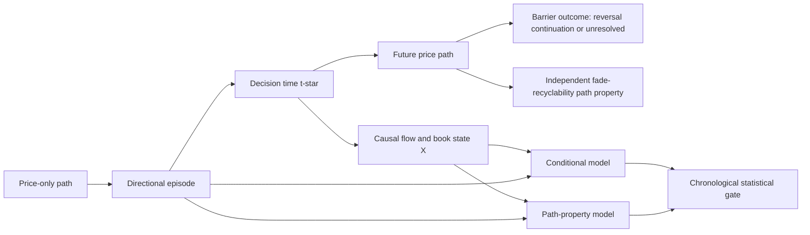

# Treasury Futures Aggression, Move-Exhaustion, and LIFO Research Program

## Scientific design, implementation, evidence, and operational state

**As of:** 2026-08-18  
**Scope:** Full aggression program: V1, V1.2, V2, V2.1, V2.2, V2.3, V2.4, V2.6, V3, move-exhaustion V1/V2, options/depth studies, statistical re-evaluation, and autoresearch.  
**Evidence status:** Research and observability only. No result in this document authorizes automated execution or a production directional signal.

---

## Abstract

This program asks whether Treasury-futures order flow contains incremental
information about the path of price after a substantial directional move has
already occurred. The economically relevant barrier distinction is among:

1. **reversal / realized exhaustion**;
2. **continuation / realized breakout**; and
3. **unresolved paths that touch neither barrier within the horizon**.

LIFO friendliness is a separate path target. It is an empirical question
whether unresolved paths are more recyclable; the class name alone does not
establish oscillation or LIFO behavior.

The central estimand is

\[
P(Y_t \mid X_t,\mathcal P_t),
\]

where \(Y_t\) is a future, price-defined outcome; \(X_t\) contains causal
aggressive-flow, passive-flow, liquidity, and price-response variables; and
\(\mathcal P_t\) is the price path into the decision time.

The project has produced several live and manual research monitors, two
move-exhaustion programs, a common statistical gate, and a hash-bound
autoresearch campaign. It has also produced a large body of negative evidence.
The first move-exhaustion program reported development ROC-AUC about 0.87 and
Brier about 0.13 for its F7 classifier, but its selected policy failed after
costs and its performance was unstable across weeks and dates. In the
event-granularity Move Exhaustion V2 program, no exploratory flow proxy
advanced from the locked 75-date discovery prefix to a confirmatory contract;
validation and final holdout were never scored. Autoresearch E001 and E002
were not confirmed on their frozen validation cohort. Consequently, the
monitors should be interpreted as measurement, decomposition, paper-tracking,
and hypothesis-generation surfaces—not as validated trading systems.

---

## 1. How to read this document

Four levels must remain separate:

1. **Scientific definition** — what is being estimated and how an episode,
   feature, or outcome is defined.
2. **Implementation** — what the current code and dashboards actually compute.
3. **Evidence** — what passed or failed a chronological, multiplicity-aware
   evaluation.
4. **Operation** — what is live, manual-only, isolated, or prohibited.

A feature can be implemented without being validated. A display label can be
useful for observation without being predictive. A classifier can improve an
offline score without surviving costs, stability checks, or an untouched
holdout.

### 1.1 Source-of-truth precedence

When sources disagree and the candidate sources occupy different authority
tiers, use this order:

1. hash-pinned frozen contracts/configuration and execution manifests;
2. append-only experiment results, decisions, and final reports;
3. current executable code and tests for implementation behavior;
4. current package documentation;
5. Memory Bank summaries and historical plans.

This distinction matters because some early READMEs describe an older
artifact-only phase while the current package has since acquired a live
pipeline. Scientific definitions remain bound to frozen research contracts;
runtime behavior is determined by current code.

When same-tier sources conflict, this document records the conflict rather than
silently choosing a winner. Current Move Exhaustion V2 execution artifacts
record C-drive data and C001–C018 complete, while frozen configuration and the
binding workspace rule name D-drive roots and state that C001 has not started.
Current launchers and Memory Bank records also show V2.2 SOD/Tailscale wiring
while the binding workspace rule says manual-only. This monograph is not an
authorization instrument; the restrictive rule governs future action until
the owner reconciles the records.

### 1.2 Status of the original Move Exhaustion V2 design

Only X0 and X1 remained frozen prerequisites. On 2026-08-11, X2–X10 were
retired to the backlog as execution contracts. Their definitions remain useful
as scientific design templates, but no result may claim evidentiary status
under those retired contracts. C001–C018 were reduced exploratory proxies on
discovery data and are `EXPLORATORY / NOT EVIDENCE`. Any confirmatory use
requires a new, owner-approved, hash-bound contract.

---

# Part I — Scientific question and causal design

## 2. Research goal

The objective is to determine whether order-flow information can identify:

1. exhaustion / reversal opportunities;
2. breakout / continuation opportunities; and
3. LIFO-friendly price paths.

The primary competing-risk question is:

> Conditional on a substantial directional price move having already
> occurred, can aggressive and passive flow predict whether the next
> barrier outcome is **REVERSAL**, **CONTINUATION**, or **UNRESOLVED** by
> \(H\)?

The independent path-property question is whether the post-\(t^\ast\) path is
fade-recyclable under a separately frozen scoring rule, and whether causal flow
state predicts that score. `UNRESOLVED` is not inherently oscillatory or
LIFO-friendly.

The program is successful even if the answer is “no.” A null result establishes
that the apparent signal is primarily a property of the preceding price path
rather than incremental microstructure information.

## 3. Separate market state, features, and future outcome

Exhaustion must not be defined with the same flow variables later used to
predict exhaustion. The causal sequence is:



The episode, barrier label, and independently scored path property are
price-defined. Flow is observed only as a candidate predictor.

## 4. Notation

- \(m_t\): mid-price or designated TY/ZN price at time \(t\).
- \(t_0\): episode origin.
- \(t^\ast\): first time the price-only move reaches the qualification barrier.
- \(s\in\{-1,+1\}\): episode direction; \(+1\) for an upward move and \(-1\)
  for a downward move.
- \(B\): required directional move from \(t_0\).
- \(x\): maximum permitted counter-directional pullback before qualification.
- \(R\): reversal barrier after \(t^\ast\).
- \(C\): continuation barrier after \(t^\ast\).
- \(H\): maximum future horizon.
- \(\mathcal P_t\): price path available through the decision time.
- \(X_t\): causal flow, book, price-response, and context features.
- \(Y_t\): future outcome.
- \(\mathcal F_t\): information available no later than time \(t\).
- \(D_t\): explicitly named pre-event depth state used by an expected-impact
  model; it is not an unobserved generic liquidity quantity.
- \(CXL^{bid},CXL^{ask}\): at-touch cancellation size, named to avoid
  collision with continuation barrier \(C\).
- \(g,a\): LIFO path profit and adverse barriers in ticks.
- \(q\): integer position size under a separately validated risk rule.
- \(\epsilon\): small positive stabilizer used in ratios.
- One TY/ZN tick: \(1/64=0.015625\) price points.

Price bps and futures ticks are not interchangeable. Tick-based definitions
are primary in the event-level program; bps equivalents are descriptive and
vary with the futures price and duration.

## 5. Conceptual market states

These are observable hypotheses, not future labels.

### 5.1 Exhaustion candidate

- a large directional price move has occurred;
- additional aggressive flow moves price less efficiently;
- opposing-side replenishment or absorption increases;
- price and flow diverge;
- aggressive flow decelerates or reverses.

### 5.2 Breakout candidate

- a large directional move has occurred;
- same-direction aggressive flow remains strong;
- price continues to respond efficiently;
- passive liquidity supports the move or withdraws from its path.

### 5.3 Balanced

- price movement is limited;
- aggressive and passive contributions are limited or balanced.

### 5.4 Pressure building

- directional flow is strong;
- price has moved little so far.

This state is intrinsically ambiguous:

\[
\text{strong flow}+\text{little price movement}
\]

can mean absorption before reversal, or temporary resistance before liquidity
disappears and price breaks out. The future barrier outcome resolves that
ambiguity; the state definition must not.

## 6. Directional price episodes

An episode qualifies when

\[
s(m_t-m_{t_0})\ge B
\]

before a pullback from the running extreme exceeds \(x\).

Specified price-only episode variables include:

- total move in ticks and bps;
- time to \(B\);
- number of price changes;
- trade count;
- LOB-event count;
- maximum pullback;
- realized volatility;
- path velocity and acceleration.

The current X1 builder records move, pullback, duration, and event/trade/price
clocks. Some higher-order velocity/acceleration fields remain proposed derived
features rather than guaranteed columns in every artifact.

The implemented event state machine is directional. The first eligible event
anchors each direction; a failed candidate restarts from the current event;
the opposite-direction candidate remains independent. Canonical order is
`(trading_date, ts_event, sequence)`. Pullback failure is strictly greater than
\(x\), and anchor separation is five wall-clock minutes per direction.

### 6.1 Move Exhaustion V2 frozen episode grid

For the MBP-1 event-level program:

- primary \(B=8\) ticks;
- primary \(x=2\) ticks;
- \(B\in\{4,6,8,12\}\);
- \(x\in\{1,2,3,4\}\);
- volatility-normalized \(x\) is deferred;
- episode universes are indexed by \((B,x,H)\);
- blocking and minimum anchor separation are per direction;
- an anchor blocks the full corresponding \(H\), not merely until an early
  barrier touch.

## 7. Future outcome labels

From \(t^\ast\), define competing first-passage times.

For an upward move:

\[
\tau_R=\inf\{h>0:m_{t^\ast+h}-m_{t^\ast}\le -R\},
\]

\[
\tau_C=\inf\{h>0:m_{t^\ast+h}-m_{t^\ast}\ge C\}.
\]

For either direction define

\[
z_h=s(m_{t^\ast+h}-m_{t^\ast}),
\]

\[
\tau_R=\inf\{h>0:z_h\le-R\},\qquad
\tau_C=\inf\{h>0:z_h\ge C\}.
\]

If both barriers first appear at the same `ts_event`,
\(\tau_R=\tau_C\le H\), the row is marked `UNRESOLVED_AMBIGUOUS` and excluded
before defining the primary outcome. Otherwise,

\[
Y=
\begin{cases}
\text{REVERSAL}, & \tau_R\le H\text{ and }(\tau_C>H\text{ or }\tau_R<\tau_C),\\
\text{CONTINUATION}, & \tau_C\le H\text{ and }(\tau_R>H\text{ or }\tau_C<\tau_R),\\
\text{UNRESOLVED}, & \tau_R>H\text{ and }\tau_C>H.
\end{cases}
\]

Thus the primary competing-risk outcome set is

\[
\mathcal Y=\{\text{REVERSAL},\text{CONTINUATION},\text{UNRESOLVED}\}.
\]

The implemented X1 artifact serializes the third member with the legacy token
`OSCILLATORY_UNRESOLVED`. That storage name does not assert oscillation,
fade-recyclability, or LIFO friendliness. `UNRESOLVED_AMBIGUOUS` is an excluded
same-event tie state, not a fourth primary outcome.

Thus:

\[
\text{realized exhaustion}\approx\text{reversal before continuation},
\]

\[
\text{realized breakout}\approx\text{continuation before reversal}.
\]

The primary Move Exhaustion V2 cell is \(R=C=4\) ticks and \(H=15\) minutes.
The frozen design grid is

\[
(R,C)\in\{(2,2),(4,4),(8,8),(3,5),(5,3)\},
\qquad H\in\{5,15,30\}.
\]

Before evidence, a discovery cell requires at least 100 resolved episodes,
unresolved share at most 80%, and no class above 90%. The completed exploratory
loop executed only the primary cell on the 75-date prefix, not this full grid.

### 7.1 Ambiguity and censoring

- If both barriers occur at the same `ts_event`, regardless of intra-burst
  sequence, the event is `UNRESOLVED_AMBIGUOUS` and excluded from that barrier
  comparison.
- If the complete horizon is unavailable, the episode is
  `CENSORED_INCOMPLETE_HORIZON`.
- Episodes intersecting known halts are censored before outcomes are inspected.
- On a day that passed source-coverage QC, an interval with no selected-contract
  MBP-1 event is observed no L1 change, not missing data.
- Q3-failing days never enter X1. Complete-horizon eligibility requires both
  scheduled-close coverage and source events through \(t^\ast+H\), except that
  event absence inside a Q3-passing covered interval is observed no L1 change.
- The label horizon must equal the \(H\) used to construct the episode universe.

## 8. Multiple clocks

Clock time alone is not sufficient. Five thousand aggressive sells can hit the
bid without changing price; a price-change clock would erase that evidence.

The event program retains:

\[
N_{\mathrm{LOB\ events}},\quad
N_{\mathrm{trades}},\quad
N_{\mathrm{price\ changes}},\quad
T_{\mathrm{wall}}.
\]

Clock assignment is family-specific:

- passive-flow and book-state features use **LOB-event time**;
- aggressive-flow features use **trade-event time**;
- outcome barriers may be evaluated in price-change time, event time, or wall
  time, but every variant has an outer wall-clock \(H\) censor;
- wall-clock duration and event/trade/price-change intensity are covariates,
  rather than substitutes for the event clocks.

The implemented X1 barrier outcomes use wall-clock horizons;
price-change/event-horizon variants were deferred. All four clocks remain path
descriptors and barrier-time outputs. The implemented detector in the existing
V2-based move-exhaustion program (`scripts/move_exhaustion/`) consumes completed
one-minute rows from the frozen V2 panel. MBP-1 LOB/trade-event-clock work
belongs to the frozen Move Exhaustion V2 research design; it is not a deployed
monitor. Candidate event lookbacks in that design are

\[
N\in\{10,25,50,100,250,500\}.
\]

## 9. LIFO-friendly as a path property

LIFO-friendly is not defined as “not exhaustion.” Let \(d\in\{-1,+1\}\) be
trade direction and suppose staged entries occur adversely in that direction.
For triggered entry \(j\), with observation capped at the parent episode's
\(t^\ast+H\),

\[
\tau_j^{profit}=\inf\{0<h\le t^\ast+H-t_j:
d(m_{t_j+h}-p_j)\ge g\},
\]

\[
\tau_j^{stop}=\inf\{0<h\le t^\ast+H-t_j:
d(m_{t_j+h}-p_j)\le-a\}.
\]

A recyclable entry satisfies

\[
\tau_j^{profit}<\tau_j^{stop}.
\]

Define

\[
LIFOScore=
\frac{\#\text{ triggered later entries reaching profit before stop}}
{\#\text{ triggered later entries}}.
\]

The score is `NaN` if no later entry triggers. Same-timestamp profit/stop ties,
and paths touching neither barrier by the cap, require an explicit frozen rule.
The current exploratory score independently grades hit-before-stop paths; it
does not enforce literal last-in-first-out liquidation order. “Frictionless
fade-recyclability score” is therefore the precise interpretation.

The original retired X9 template is not an executable score: its \(g/a\) grid,
clip/reset rules, inventory convention, and tie/missing-path policy were never
frozen under an active contract. The reduced C011 proxy is reproducible,
however, and must not be substituted for X9. On the 75-date
\(B=8,x=2,R=C=4,H=15\)-minute discovery prefix it used one equal-weight
hypothetical clip at each of \(k\in\{1,2,3\}\) triggers. A trigger occurs when,
strictly after \(t^\ast\), mid first reaches
\(m_{t^\ast}+s\,k\) ticks; entry is exactly that trigger mid. With
\(g=a=2\) ticks, the clip wins only if mid subsequently reaches
\(-s\,g\) from entry strictly before \(+s\,a\), capped at
\(t^\ast+15\) wall-clock minutes. A same-row/tied first touch is a loss;
stop-only and neither-hit-by-cap paths are losses. The denominator is the
number of triggered clips, each weighted once; no trigger gives `NaN`.
`UNRESOLVED_AMBIGUOUS` and incomplete-horizon rows were excluded, only
price-change rows were scanned, and no spread, queue, fill, cost, partial-fill,
or literal liquidation-order convention was modeled.

Associated path descriptors are maximum inventory, drawdown, adverse/favorable
ticks, time to unwind, capital-time, and fraction of later clips recycled.
These can be measured frictionlessly before any claim about executable fills.
Later triggers necessarily have shorter exposure and must be reported
separately or normalized.

### 9.1 Repeated signals while price falls

A later buy signal is scientifically distinct from mechanical averaging down
only if exhaustion evidence strengthens—for example:

\[
IS\uparrow,\qquad IE\downarrow,\qquad NR^{opp}\uparrow.
\]

The required comparison is \(P(\text{reversal}\mid\text{second signal})\) versus
\(P(\text{reversal}\mid\text{first signal})\), with MAE/MFE and inventory risk.
First/second-signal definitions, strengthening thresholds, same-episode rules,
and reset rules were never frozen under an active X10 contract; X10 is retired.

### 9.2 Signals after reversal begins

Once price is rising after an exhaustion-buy candidate, the state may have
changed from exhaustion fade to reversal momentum:

\[
\text{Impulse}\rightarrow\text{Exhaustion Candidate}
\rightarrow\text{Reversal Confirmed}\rightarrow\text{Reset}.
\]

Persistent same-direction signals during continued movement may instead
support continuation. Identical exhaustion alerts should not fire indefinitely
after the original state has resolved.

---

# Part II — Data, flow, and feature definitions

## 10. Instruments, symbols, and units

The curve monitor uses:

- FV / ZF: 5-Year Treasury futures;
- TU / ZT: 2-Year Treasury futures;
- TY / ZN: 10-Year Treasury futures;
- US / ZB: 30-Year Treasury futures.

V1 maps dashboard symbols to Databento parents:

```text
FV -> ZF.FUT
TU -> ZT.FUT
TY -> ZN.FUT
US -> ZB.FUT
```

The configured approximate DV01 weights in dollars per bp per contract are:

```text
FV 42, TU 36, TY 85, US 125
```

DV01 weighting makes cross-tenor signed volume more comparable. It does not
convert a TY price target into yield bps.

## 11. Data sources

### 11.1 AccessAPI

- live TBBO WebSocket: `ws://100.79.30.21:8001/ws/live/stream`;
- recent TBBO seed: `/live/tbbo/recent`;
- historical TBBO database endpoint for the V2 matrix;
- primary live source for V1/V2-family monitors.

### 11.2 Databento

- historical parent-symbol trades for V1;
- direct live TBBO backup for V1 and V2.2-derived buffers;
- ZN MBP-1 event archive for Move Exhaustion V2;
- ZN MBP-10 files for depth research.

### 11.3 Other read-only sources

- `workspace/economic_events.db` for scheduled-event context;
- `C:\uikitxv2_cache\gamma_tracker\gamma_tracker_v3.db` for options skew/gamma
  research, opened read-only;
- `workspace/analysis/aggression_v2_tbbo/tbbo_feature_matrix.csv` for legacy
  1-minute research;
- immutable autoresearch publication
  `v20260722_phase0_v3_dense_20260226`.

## 12. Session and front-contract conventions

Three conventions coexist and must not be silently mixed.

### 12.1 Legacy V1/V2 convention

- session window: 01:00–17:00 ET;
- `day_open_price`: first price in that window;
- live V1 default start: 01:00 ET;
- V1 historical front: same-UTC-date maximum-volume instrument.

### 12.2 Autoresearch and Move Exhaustion V2 convention

- trading session: prior calendar day 18:00 ET through trading date 17:00 ET;
- product calendar: `CME_InterestRate`;
- front contract: prior complete session's volume ranking, with deterministic
  tie-breaking;
- roll choice is therefore causal.

### 12.3 API-implicit front series

Some AccessAPI TBBO research requests use dashboard symbols directly and rely
on the service's front-series mapping. These rows are not automatically
contract-identical to parent-symbol or prior-session-selected series.

Any live-to-offline parity claim must name its session and front-contract rule.

## 13. Aggressor classification

For trade side:

- `B` / `BID`: buyer aggressed, lifted the ask, sign \(+1\);
- `A` / `ASK`: seller aggressed, hit the bid, sign \(-1\);
- unknown/neutral: sign \(0\), or explicit `AGG_UNKNOWN`, `ADD_UNKNOWN`,
  `CXL_UNKNOWN`, and `MOD_UNKNOWN` in the MBP-1 store.

Unknown-side MBP-1 rows advance event clocks and update the post-event L1
state, but never enter side-specific aggressive or passive features. Side is
not inferred.

Signed aggressive flow over bucket \(k\) is

\[
AF_k=M_k^b-M_k^s,
\]

where \(M_k^b\) and \(M_k^s\) are aggressive buy and sell volume.

Aggressive imbalance is

\[
AI_k=\frac{M_k^b-M_k^s}{M_k^b+M_k^s+\epsilon}.
\]

For the curve monitor:

\[
\text{signed DV01 flow}
=\text{aggressor sign}\times\text{size}\times DV01.
\]

## 14. TotalAggress and buy/sell pressure

V1 aggregates signed DV01 flow to one-minute buckets and computes

\[
TotalAggress_t=\sum_{j\le t} AF_j^{DV01}.
\]

Reset modes include none, daily, and Globex. The default V1 window begins at
01:00 ET, so display behavior is session-like even when the explicit reset is
none.

The one-minute buy/sell ratio is

\[
100\frac{\text{signed flow}}
{\text{aggressive buy volume}+\text{aggressive sell volume}+\epsilon},
\]

smoothed with an EMA of span 10 for display and V2 features.

## 15. Depth-normalized aggressive flow

Symmetric normalization:

\[
AF_k^{D,sym}
=\frac{AF_k}{(Q_k^a+Q_k^b)/2+\epsilon}.
\]

Directionally relevant normalization:

\[
AF_k^{D,dir}
=\frac{M_k^b}{Q_{k,pre}^a+\epsilon}
-\frac{M_k^s}{Q_{k,pre}^b+\epsilon}.
\]

The directional version has the economic appeal that aggressive buying
consumes ask liquidity and aggressive selling consumes bid liquidity. The
frozen design retained both normalizations and did not resolve which should be
the headline measure; that choice requires a contract-specific decision.

For every classified execution/event \(j\), \(Q_{j,pre}^{a,b}\) means the last
valid, non-crossed L1 snapshot in strict source order **before** that event. It
is never post-trade depth. A stale, missing, non-positive, or crossed snapshot
(`ask < bid`) makes that event's normalized value `UNKNOWN`/missing, not zero;
a future contract must freeze the staleness and minimum-depth-coverage rules.
Unknown-side executions remain outside side-specific numerators.

Window aggregation must not equally average unstable event ratios. For eligible
buy and sell sets \(\mathcal B_W,\mathcal S_W\), a ratio-of-sums form is

\[
AF_{W}^{D,dir}
=
\frac{\sum_{j\in\mathcal B_W}v_j}
     {\sum_{j\in\mathcal B_W}Q_{j,pre}^{a}+\epsilon}
-
\frac{\sum_{j\in\mathcal S_W}v_j}
     {\sum_{j\in\mathcal S_W}Q_{j,pre}^{b}+\epsilon}.
\]

The symmetric analogue sums signed volume in the numerator and the eligible
pre-event mean depths in the denominator. Define the eligible event ratio as
\(r_j=v_j/Q^a_{j,pre}\) for a buy and
\(r_j=-v_j/Q^b_{j,pre}\) for a sell. If these ratios are pooled directly, use
the declared volume-weighted form
\(\sum_j v_jr_j/\sum_jv_j\), not an equal-weight mean. Reports must provide the
ratio-of-sums aggregate, the volume-weighted aggregate, and the median eligible
event ratio as robustness, together with eligible/missing depth counts.

Reduced C001 did **not** implement this event-by-event definition. It divided
direction-aligned aggressive size from the last 100 pre-\(t^\ast\) store rows
by `pre_bid_sz + pre_ask_sz` on the \(t^\ast\) row, then stratified on
post-\(t^\ast\) MFE. Its result applies only to that reduced proxy and cannot
validate the design-level depth normalization.

## 16. Other aggressive-side variables

### 16.1 Sweep intensity

With full depth, the conceptual quantity is volume executed beyond best divided
by total aggressive volume. An ordinary MBP-1 execution packet need not expose
the volume executed beyond the best quote, so that quantity is not generally
reconstructible from MBP-1. The frozen template's proposed L1 proxy is

\[
SweepProxy_k=
\frac{\text{volume in same-sequence trade bursts displacing price }\ge1
\text{ tick}}
{\text{total aggressive volume}+\epsilon}.
\]

The current reduced sweep representation is a multi-level/sequence-pattern
count, not true executed-beyond-best volume and not the numerator in the
conceptual quantity. It must therefore be described as a pattern-count sweep
proxy, not “sweep intensity.” The required MBP-10 overlap validation is absent
for the V2 archive window, so neither reduced proxy is validated or promotable.

### 16.2 Arrival intensity

\[
\lambda_k^b=\frac{N_k^{aggressive\ buys}}{\Delta t},\qquad
\lambda_k^s=\frac{N_k^{aggressive\ sells}}{\Delta t}.
\]

Changes \(\Delta\lambda\), signed-flow acceleration, sign persistence, and
deceleration are retained separately from total flow.

### 16.3 Large trades

The legacy TBBO matrix defines a large trade as size at least 100 contracts.
`large_trade_share` is the fraction of volume in these prints.

## 17. Passive-flow definitions

Observed at-touch passive activity is represented by size:

\[
L^{bid},\quad L^{ask},\quad CXL^{bid},\quad CXL^{ask},
\]

where \(L\) denotes liquidity added and \(CXL\) liquidity cancelled at the
specified side.

For an upward episode:

\[
PF^{up}=L^{bid}+CXL^{ask}-L^{ask}-CXL^{bid}.
\]

The downward definition reverses signs. Bid additions and ask cancellations
support an upward move; ask additions and bid cancellations resist it.

MBP-1 observes only events that change L1. Deeper resting liquidity is absent.
Modify events are decomposed from consecutive L1 states into add-like,
cancel-like, cancel+add, or unknown components. These are at-touch proxies,
not complete order-book flow. The frozen same-contract comparison hierarchy is
L1 price, aggregate size, then order count; an initial or no-op modify remains
`MOD_UNKNOWN`.

## 18. Replenishment and absorption

During aggressive buying:

\[
RR_k^{ask}=\frac{L_k^{ask}}{M_k^b+\epsilon},
\]

\[
NR_k^{ask}=
\frac{L_k^{ask}-CXL_k^{ask}}{M_k^b+\epsilon}.
\]

During aggressive selling:

\[
RR_k^{bid}=\frac{L_k^{bid}}{M_k^s+\epsilon},
\]

\[
NR_k^{bid}=
\frac{L_k^{bid}-CXL_k^{bid}}{M_k^s+\epsilon}.
\]

\(RR^{opp}\) and \(NR^{opp}\) mean the ask-side quantities for upward moves
and bid-side quantities for downward moves.

Strong aggressive buying with persistent ask replenishment, or strong
aggressive selling with persistent bid replenishment, is a candidate
absorption mechanism. It is not evidence of future reversal until tested
conditional on the preceding price path and aggressive flow.

## 19. Price impact and flow effectiveness

The central exhaustion hypothesis is that additional aggressive flow becomes
less effective after a large move.

### 19.1 Impact efficiency

\[
IE_t=
\frac{s\Delta m_t^{bps}}{|AF_t^D|+\epsilon}.
\]

- high positive \(IE\): price progresses efficiently in the episode direction;
- low positive \(IE\): possible absorption;
- negative \(IE\): price moves against the episode direction.

The ratio is unstable when flow is near zero and must be winsorized or replaced
with a local slope. It indicates movement against aggressive flow only when the
measurement is restricted to confirming-flow windows with \(sAF^D>0\).

A causal implementation must freeze the interval convention. A contemporaneous
feature pairs flow on \((t-\Delta,t]\) with price response over that same
interval. An explicitly delayed response on \((t,t+\ell]\) is a training or
evaluation target, never a feature available at \(t\). The contract must also
set a minimum-flow eligibility floor; observations below it are missing or
ineligible rather than stabilized into extreme ratios by \(\epsilon\).
Clipping/winsorization thresholds and any robust scale are learned on training
dates only and applied unchanged. No forming or future bar may enter a feature.
These are design requirements unless a cited implementation artifact states
that it applied them; the general \(IE\) formula alone does not prove that.

### 19.2 Rolling impact slope

\[
\Delta m_j=\alpha_t+\beta_t AF_j^D+\varepsilon_j.
\]

The historical X3 template splits pre-\(t^\ast\) observations into early,
middle, and late thirds by trade-event count, requires at least 15 trades per
third, estimates only with data ending at \(t^\ast\), compares trade-event and
LOB-event clocks under both AF normalizations, winsorizes slopes at p1/p99, and
requires a shuffled-third placebo. It defines:

\[
ImpactDecay=
\frac{\beta_{late}}{\beta_{early}+\epsilon}.
\]

The preregistered exhaustion direction is

\[
E[ImpactDecay\mid reversal]
<
E[ImpactDecay\mid continuation].
\]

The ratio is unstable when \(\beta_{early}\) is near zero and can be
sign-distorting for negative slopes. Any future confirmatory contract must
freeze an eligibility floor or a governed signed-denominator rule. C002/C003
used reduced aggregate-impact proxies rather than this full OLS-thirds design.

### 19.3 Impact shortfall

Fit an expected-impact model strictly out of sample:

\[
\widehat{\Delta m_t}
=f(AF_t^D,PF_t,D_t,Spread_t,\sigma_t,TOD_t,\ldots).
\]

Then

\[
IS_t=s(\widehat{\Delta m_t}-\Delta m_t).
\]

Large positive \(IS\) means price moved less in the impulse direction than
expected from the observed state. It must be checked against the mechanical
failure mode \(IS\approx-\text{realized progress}\).

The historical X4 template fits and freezes the expected-impact model
walk-forward within discovery, standardizes \(IS\) by era, evaluates \(t^\ast\)
and declared pre-\(t^\ast\) checkpoints, reports model fit without gating on
it, and requires the conditional effect to survive control for realized
progress. The “100% of \(B\)” checkpoint is \(t^\ast\), so it must not be
double-counted. C014 used an AF-only, N=100 OLS proxy and is not X4 evidence.

## 20. Price/flow divergence

Directional price progress is

\[
P_t=s(m_t-m_{t_0}),
\]

and cumulative normalized flow is

\[
F_t=s\sum_{j=t_0}^{t}AF_j^D.
\]

Raw \(P_t-F_t\) is invalid because units differ. Use standardized quantities
or an expected-impact residual such as \(IS\).

## 21. Quote, book, and context variables

### 21.1 Quote-at-trade features

- spread: ask minus bid;
- size imbalance:
  \[
  \frac{Q^b-Q^a}{Q^b+Q^a+\epsilon};
  \]
- displayed depth: \(Q^b+Q^a\);
- trade size divided by displayed depth;
- depth-adjusted signed flow.

TBBO quote fields are the best quote at trade time, not a full quote-update
history.

### 21.2 Price context

- trailing 5m/30m realized volatility;
- 5m momentum;
- move speed and acceleration;
- maximum pullback;
- time of day/session;
- scheduled macro-event window;
- event intensity;
- roll/opening-period indicators;
- cross-tenor agreement.

Cross-tenor agreement applies to legacy curve/TBBO studies. The ZN-only Move
Exhaustion V2 archive does not itself supply a causal cross-tenor feature; that
historical design item remained unresolved.

### 21.3 Options context

Read-only gamma-tracker studies use ATM/backbone volatility and RR25/RR50/RR75
skew. RR50 is call IV minus put IV at 50-delta under the matched-leg
construction. Empirical sign must be calibrated; broad skew direction did not
predict TY in the available sample.

---

# Part III — Models, evaluation, and evidence control

## 22. V1 fair-value models

### 22.1 Intraday OLS

\[
price_t=\alpha+\beta TotalAggress_t+\varepsilon_t.
\]

- minimum 30 aligned points;
- fit once per ET session and freeze;
- `residual = price - predicted`;
- large residual display threshold: \(|z|\ge2\).

This model powers the V1 intraday fair-value panel and descriptive
flow-dominance decomposition.

### 22.2 Ten-business-day OLS

\[
priceDelta_t=price_t-dayOpen_t,
\]

\[
priceDelta_t=\alpha+\beta TotalAggress_t+\varepsilon_t.
\]

It pools ten business days and reconstructs

\[
fairValue_t=dayOpen_t+\widehat{priceDelta_t}.
\]

## 23. V2 Ridge fair value

V2 predicts within-day deviation, not raw price:

\[
target_t=price_t-dayOpen_t,
\]

\[
fairValue_t=dayOpen_t+\widehat{target_t},
\]

\[
residual_t=price_t-fairValue_t.
\]

The fitted model uses a standardized RidgeCV pipeline with alpha grid
\(\{0.01,0.1,1,10,100\}\), clean-day filters, and an 18-feature set:

- `agg_cum_daily`, `agg_5m`, `agg_30m`;
- `buysell_ratio`;
- `trade_intensity`, `avg_trade_size`, `large_trade_share`;
- `realized_vol`, `mom_5m`;
- `FV_agg_5m`, `TU_agg_5m`, `US_agg_5m`;
- `spread_mean`, `size_imbalance_mean`, `displayed_depth_mean`;
- `trade_size_vs_depth`, `depth_adjusted_signed_flow`;
- `minutes_since_open`.

The live residual z-score uses `prior_blend_v1`: historical residual
mean/volatility are blended with expanding moments of the supplied live frame.
`PRIOR_OBSERVATIONS=60`; the expanding component requires 30 points.

This is a material live/offline parity limitation. In historical training,
`day_open_price` is the first bar of the defined 01:00 session. In current live
code, it is the first retained buffer price; `agg_cum_daily` and expanding
residual moments accumulate over the retained frame without ET-date grouping.
The buffer can retain 18 hours and seeds with the latest 5,000 trades. The live
quantities are therefore not guaranteed to reset at the canonical session open.

## 24. V2 residual alert state machine

Fixed thresholds:

```text
WATCH_Z = 1.5
DISLOCATION_Z = 2.0
RESET_Z = 1.0
HORIZON = 30 minutes
TICK_SIZE = 1/64
```

States:

- `NONE`;
- `WATCH` when \(|z|\ge1.5\);
- `DISLOCATION` when \(|z|\ge2.0\).

A positive residual means price is rich; a negative residual means cheap. The
research fade direction is \(-sign(residual)\). An episode is marked resolved
when \(|z|<1\), but the lifecycle remains open and blocks another episode until
the full 30-minute deadline. A WATCH that later exceeds 2 retains initial state
WATCH and sets an escalation flag. At the deadline the episode closes as
resolved or expired/interrupted. Resolution is not equivalent to trade profit
because fair value can move toward price.

Stored diagnostics include 15m/30m directional move, MAE, close price/fair
value, price share of reversion, and resolution time. Legacy dashboard PnL is
observational and can omit full execution costs.

### 24.1 Retired original design templates and ID mapping

The eight frozen-register families are: X1 price-only baseline; X2 aggressive
flow conditional on price; X3 impact decay; X4 impact shortfall; X5 passive
absorption; X6 deceleration versus sign reversal; X7 nested incremental
information; and X8 the interpretable full multinomial model. The supplied
conceptual design also refers to impact decay as “X2.” That is numbering drift:
the hash-pinned repository register assigns impact decay to X3. This document
preserves the scientific template in Section 19.2 and names both the family and
frozen-register ID rather than silently relabeling either source.

That **impact-decay template**—supplied-design X2, frozen-register X3—split the
pre-\(t^\ast\) path into trade-event early/middle/late thirds, required at least
15 trades per third, estimated local OLS impact under both AF normalizations
and trade/LOB clocks, learned p1/p99 clipping on training only, and required a
shuffled-third placebo. C002/C003 used aggregate early/late ratios or
differences, so neither executed this retired template.

The retired **X2 aggressive-flow** template matched episodes on move-magnitude
tercile, velocity tercile, and volatility regime; ranked
\(AF^{D,dir}\) at \(t^\ast\); and compared continuation in Q5 versus Q1.
Its six headline cells were two AF normalizations by
\(N\in\{50,100,250\}\), with date-clustered uncertainty, BH correction, an
8pp SESOI, and balance checks. C001 instead used one \(N=100\) aggregate
normalization and post-\(t^\ast\) MFE strata, so it is not an executed X2.

The retired **X5 passive-absorption** template matched on price path,
aggressive-flow quintile, and volatility, then compared reversal across
\(NR^{opp}\) or \(RR^{opp}\) terciles. It also specified an out-of-sample
nesting comparison between \(P(reversal\mid price,AF)\) and
\(P(reversal\mid price,AF,NR^{opp},PF)\), with four ratio/lookback cells plus
one model comparison and mandatory L1-versus-MBP-10 qualification. C004 used
only raw opposing-side L1 adds minus cancels over \(N=100\), nested descriptively
inside AF terciles; it did not execute X5.

The retired **X6 deceleration-versus-reversal** template classified
within-move checkpoints as accelerating, still-signed but decelerating, or
sign-reversed. It compared reversal rate, time-to-reversal, MAE, and MFE within
matched price buckets across three pairwise contrasts. The preregistered
ordering was reversed \(>\) decelerating \(>\) accelerating for reversal rate,
with deceleration expected earlier but noisier. C005 was a reduced early/late
\(N=100\) state proxy with only three reversed episodes; it did not execute
that template.

The original X7 decision experiment defined walk-forward multinomial models:

- **A:** pre-\(t^\ast\) price path only;
- **B:** A plus aggressive flow;
- **C:** B plus passive flow;
- **D:** C plus \(IE\), rolling \(\beta\), \(\Delta\beta\), and \(IS\).

Discovery fitting was walk-forward; state was to be frozen before one-shot
validation. The three contrasts B-A, C-B, and D-C formed one FDR family.
Headline metrics were multiclass Brier and log loss, with one-vs-rest
ROC-AUC/PR-AUC and calibration for each class across the full \(H\) grid.
Define

\[
\Delta Brier=Brier_{baseline}-Brier_{augmented},
\]

so positive values favor the augmented model. A nesting step required
multiclass \(\Delta Brier\ge0.005\); materiality for a specific class also
required at least +2pp one-vs-rest AUC, stability, and sign consistency across
the available era slices.

X8 specified an L2 multinomial logistic full model, coefficient report,
drop-one family ablations, per-class calibration, and secondary conditional
path targets \(E[MAE]\), \(E[MFE]\), \(P(MAE>a)\), and MAE quantiles.
Nonlinear models were out of scope until X7/X8 were understood.

X7/X8 were retired to backlog before execution. C006/C007 were reduced B-A
proxies only, at one horizon, and used post-\(t^\ast\) MFE inside their
so-called price baseline. That is future-outcome leakage. They cannot support
an incremental-prediction conclusion and must be rerun with only
pre-\(t^\ast\) price features under a new contract.

## 25. Temporal validation

Random row splits are prohibited. Signals from one move and observations from
one date remain grouped.

### 25.1 Terminology

This document uses **study-local evaluation split** for later dates used by an
individual legacy study. **FINAL holdout** means a separately locked,
untouched cohort. Historical source reports often call both “holdout”; the
distinction must be preserved when interpreting results.

### 25.2 Legacy V1/V2 studies

Most use chronological discovery/validation/FINAL or chronological 70/30 date
splits. FINAL remains locked unless a preregistered gate passes.

### 25.3 Move Exhaustion V2

- discovery: 2022–2024;
- validation: calendar 2025;
- final holdout: 2026-01 through the last eligible session no later than
  2026-04-01;
- symmetric five-eligible-date purge at each boundary;
- exploratory loop restricted to a 75-date discovery prefix;
- validation and final holdout were not scored by the loop.

Every fitted object in a future confirmatory run must be walk-forward within
discovery, then frozen. Validation may not refit or search.

The original design requested five historical era slices, but the authorized
2022–2026 archive cannot populate all five. The replacement era-consistency
rule remains unresolved and must be frozen in a future contract.

### 25.4 Autoresearch

- discovery: 298 dates;
- one-shot validation: 101 dates;
- historical quarantine: 24 diagnostic-only dates;
- prospective confirmation: separate, locked, and not opened.

Candidates cannot access evaluator-owned outcomes. Validation is transform-only
after discovery state is frozen.

## 26. Statistical inference and multiplicity

The common aggression gate uses:

- date-clustered bootstrap confidence intervals;
- one-sided tests in the preregistered direction;
- Benjamini-Hochberg FDR, usually \(q=0.10\);
- cost sensitivity at 0, 0.25, 0.5, and 1.0 ticks;
- sample/date floors;
- context stability.

The general re-evaluation vocabulary is:

- **PASS**: sample floor, FDR, positive lower confidence bound, and stability;
- **PROVISIONAL**: positive point estimate with incomplete
  sample/significance/stability evidence;
- **FAIL**: non-positive or unsupported;
- **blocked_underpowered**: cannot evaluate;
- **not_supported**: adequate test, insufficient effect.

Move Exhaustion V2 confirmatory gates are experiment-family-specific:

- 10,000 date-cluster bootstrap draws;
- for the frozen primary gate where that specification applies,
  \(n\ge200\) episodes and at least eight dates per cell;
- conditional-rate experiments: at least 8 percentage points lift;
- nested-model experiments: multiclass \(\Delta Brier\ge0.005\), and at least
  +2pp one-vs-rest AUC for a class-specific materiality claim;
- metric-specific weekly stability;
- PSI \(\le0.25\);
- no date contributing more than 40% of aggregate effect.

Define weekly stability for response/effect \(\theta\), with each weekly
estimate retaining date as the clustering/aggregation unit, as

\[
Spread_{week}(\theta)=\max_w\theta_w-\min_w\theta_w.
\]

The spread inherits the units of \(\theta\): probability-rate spread is in
probability units (0.15 means 15pp), AUC spread is in AUC units, and continuous
MAE/MFE/return effects remain in ticks, bps, or their declared score units.
The numeric 0.15 threshold must not be applied blindly to continuous outcomes.
The frozen repository file leaves that non-model unit under OQ-7; such a cell
cannot receive PASS until a metric-specific threshold is frozen.

Sample floors are also contract-specific. The \(n\ge200\) primary floor above
is not interchangeable with \(n\ge50\) used by other aggression gate
frameworks/studies. Repository
`scripts/move_exhaustion_v2/config/frozen/gates.yaml` currently records 50
for Move Exhaustion V2 and notes OQ-14, which conflicts with the supplied
frozen primary specification; this monograph does not resolve that conflict by
inference or lower the primary floor. The 100-resolved-episode discovery-cell
guardrail in Section 7 and the 30-observation exploratory C-cycle floors are
eligibility rules, not confirmatory substitutes.

Exploratory cycles receive no PASS/FAIL evidence verdict.

Autoresearch uses 9,999 validation resamples, studentized date-cluster wild
bootstrap, Holm \(\alpha=0.05\), serial circular/block-shift falsification,
absolute SESOI 0.005 Brier, 2% relative skill, and fixed multiplicity
denominators.

## 27. Evaluation metrics

### 27.1 Predictive

- ROC-AUC and PR-AUC;
- log loss;
- Brier score;
- calibration intercept/slope;
- precision/recall;
- class-conditional probability lift.

X1 also reports class base rates, forward returns, barrier times in every
retained clock, resolved/unresolved shares, and the excluded/censored counts.
At minimum, X1 conditioning enumerates move magnitude \(B\), pullback cap
\(x\), \(R/C/H\), velocity, maximum pullback, volatility regime, time of day,
event/non-event, direction, and depth regime where depth is evaluable.
Uncertainty is date-clustered. Incomplete-horizon and known-halt intersections
are censored before outcomes are inspected. Headline model results must be
shown across the declared \(H\) grid.

### 27.2 Path-dependent

- MAE and MFE;
- \(Q_{0.50},Q_{0.90},Q_{0.95}\) of MAE;
- time to reversal/continuation;
- legacy one-minute path efficiency:
  \[
  \frac{|net\ move|}{\sum |one\text{-}minute\ moves|};
  \]
- LIFOScore and time to unwind.

### 27.3 Trading

- after-cost PnL and PnL/signal;
- drawdown and maximum inventory;
- turnover and holding duration;
- fill probability;
- adverse selection conditional on fill;
- capital-time.

Predictive, path, and execution claims are separate. Move Exhaustion V2 is
explicitly an information-content study and applies no tradability gate.

## 28. Future limit-order realism requirements

This section is outside the authorized Move Exhaustion V2 scope; former X11
was retired. These are mandatory design requirements before any separately
approved program can make executable claims. They have not been implemented or
validated here; any numerical illustration is non-evidentiary.

A bid touch is not a fill. A future execution study must track queue ahead
\(Q_0^{ahead}\) and require enough aggressive sell volume, queue depletion, and
relevant cancellations to clear it.

Three assumptions must be bracketed:

- conservative: cancellations never improve our queue;
- intermediate: a specified fraction occurs ahead;
- optimistic: cancellations reduce queue proportionally.

Required outputs are \(P(fill)\), adverse move conditional on fill, reversal
conditional on no fill, and \(E[PnL\mid fill]\). This has not been implemented
with true queue position because MBO data are unavailable. V2.4 is a simple
completed-row paper specification, not queue simulation. A future contract
must additionally freeze decision latency, entry timestamp/price, partial
fills, cancellation-ahead rules, quote moves, resets, timestamp ties, and the
maximum fill/holding horizon.

---

# Part IV — Implemented monitor lineage

## 29. System map

| Surface | Port | Purpose | Write root | Status |
|---|---:|---|---|---|
| V1 | 5050 | DV01 curve flow, OLS fair value, descriptive dominance | `_totalaggress_cache/` | live descriptive |
| V1.2 | 5056 | RANGE caution, soft B=4, LIFO display | `aggression_v12_live/` | manual provisional |
| V2 | 5052 | Ridge fair value and residual episodes | `aggression_v2_live/` | research monitor |
| V3 | 5053 | V2 plus flow-effort regimes/drivers | `aggression_v3_live/` | SOD research |
| V2.1 | 5054 | event-flow T+5 paper lock | `aggression_v21_live/` | manual provisional |
| Autoresearch Lab | 5057 | discovery-only hypothesis lab | `autoresearch_lab/` | manual exploratory |
| V2.2 | 5058 | V2 plus LIFO FRIENDLY | `aggression_v22_live/` | deployment records conflict |
| V2.3 | 5059 | reduced move-exhaustion context | `aggression_v23_live/` | manual provisional |
| V2.4 | 5060 | dislocation paper-trade specification | `aggression_v24_live/` | manual paper |
| V2.6 | 5062 | reduced C018 + LIFO + human grades | `aggression_v26_live/` | manual provisional |

V2.5 was proposed for options context and was not built because its
study-local evaluation gate failed.

Operational records show V1, V2.2, and V3 in `run_all_sod.bat`; a separate
Task Scheduler wrapper restarts base V2 at 18:00; and a launcher advertises a
V2.2 Tailscale mapping on external port 8444. These observations do not
supersede the binding rule that V2.2 is manual-only. The Tailscale launcher
prints the URL but does not itself prove proxy configuration or authentication.
Telegram is a separate process, not a dashboard-integrated execution channel.

### 29.1 HTTP/API and write behavior

- V1: `/`, `/api/config`, `/api/live_status`, `POST /api/aggression`.
- V1.2: V1-compatible routes plus range-caution and caution-log routes.
- V2/V3: config, research, signal status, live signal, and alert-log routes;
  V3 adds `flow_effort` to the live payload.
- V2.1: event-flow and event-log routes.
- V2.2: V2 routes plus `/api/lifo`.
- V2.3: V2 routes plus `/api/exhaustion`.
- V2.4: V2 routes plus `/api/paper`.
- V2.6: `/api/live`, `/api/lifo`, `/api/c018`, and mutating
  `POST /api/feedback`.
- Autoresearch Lab: read routes plus journaled job/preregistration mutation
  routes restricted by discovery-only guards.

Polling is not necessarily read-only: V2-family live endpoints can evaluate
and persist episode/log state. Any externally exposed API therefore needs the
same isolation and authentication review as an explicit write surface.

## 30. Aggression Monitor V1

Package: `scripts/aggression_dashboard/`.

### 30.1 Pipeline

1. AccessAPI live TBBO is primary.
2. Direct Databento TBBO is backup after a default 30 seconds
   stale/disconnected.
3. Return to AccessAPI requires a default 60 seconds sustained recovery.
4. Historical Databento parent trades and live rows are merged with
   sequence/nanosecond/payload boundary deduplication.
5. Curve aggression is aggregated to one minute.
6. TY price is taken from live BBO/trades with historical fallback.
7. intraday and ten-day OLS fair-value panels are built.
8. the browser polls `POST /api/aggression` every second.

The 30/60-second defaults can be overridden by
`AGG_BACKUP_STALE_SEC`/`AGG_BACKUP_RECOVER_SEC`.

### 30.2 Panels

1. TotalAggress versus price;
2. smoothed buy/sell pressure;
3. aggressive buy/sell volume;
4. intraday fair value;
5. ten-business-day fair value.

### 30.3 Descriptive flow-dominance banner

Using completed bars from the frozen intraday model:

\[
C_t^A=\beta\Delta TotalAggress_t,
\qquad
C_t^P=\Delta residual_t.
\]

\(C^P\) is **implied passive**, not resting-order identity. Fifteen-minute sums
are converted to prior-bar session-expanding z-scores.

Fixed parameters:

```text
window = 15m
dominance ratio = 1.5
quiet floor = 0.5 z
z warmup = 20 valid windows
dynamics lookback = 5m
dynamics deadband = 0.15 z
```

States:

- `AGGRESS_DOMINANT`;
- `IMPLIED_PASSIVE_DOMINANT`;
- `BALANCED`;
- `QUIET`;
- `WARMING`;
- `UNAVAILABLE`.

The banner reports the prior state and whether each component's absolute z is
increasing, slowing, or steady. It is fixed:

`DESCRIPTIVE / IMPLIED PASSIVE / NON-DIRECTIONAL / NOT RANGE-TREND VALIDATED`.

It writes no episodes and emits no trade direction.

## 31. Aggression V1.2

Package: `scripts/aggression_dashboard_v12/`.

V1.2 is an isolated manual copy using a causal pooled-prior-history OLS rather
than V1's frozen intraday OLS. It pools all earlier supplied dates; when no
historical fit exists it uses expanding same-day prior rows. Residual z uses
prior rows from the same session.

### 31.1 RANGE caution

\[
|v1ResidualZ|\ge1
\]

and absolute residual is wider than 15 minutes earlier.

Label:

`PROVISIONAL / RANGE-CAUTION / NON-DIRECTIONAL`.

The underlying validation cell was +8.13pp RANGE but had approximately zero
discovery lift and failed FDR.

### 31.2 Soft breakout lean

Fires on 10m/20m residual persistence, age at least 30m, or \(|z|\ge1.5\) with
15m speed above a causal expanding p70 threshold after a 20-row warmup. It is
explicitly `B=4` only. The primary 30m/8bps/\(k=1\) grid had zero restrictive
PASS cells; 18 restrictive PASSes existed only at the soft 4bps barrier.

Label:

`PROVISIONAL / SOFT-BREAKOUT-LEAN / B4-ONLY / NON-DIRECTIONAL`.

### 31.3 LIFO FRIENDLY

Fires when

\[
|v1ResidualZ|\ge1
\]

and trade intensity is at or below the session expanding 33rd percentile.

Validation showed +10.6pp continued-range lift; FINAL showed +8.15pp but its
one-sided CI failed. The UI says `LIFO FRIENDLY` and does not claim a
long/short.

## 32. Aggression V2

Package: `scripts/aggression_dashboard_v2/`.

The current implementation has a live TBBO/Ridge/alert pipeline even though
the earliest README describes the initial artifact-only phase.

The principal research interpretation is sparse residual dislocation:

- price rich: residual \(>0\);
- price cheap: residual \(<0\);
- candidate fade: \(-sign(residual)\);
- WATCH at \(|z|\ge1.5\);
- DISLOCATION at \(|z|\ge2\);
- reset at \(|z|<1\).

The early chronological study-local evaluation readout for \(|z|\ge2\), 30m
fade reported
\(n=492\), roughly 81.1% directional hit, and 0.0647 price-point mean move.
This was a frictionless research rule, not a costed execution result. Later
tradability, timing, and stability studies did not validate a production
strategy.

## 33. Aggression V3

Package: `scripts/aggression_dashboard_v3/`.

V3 retains V2 residual alerts and adds:

- fair-value driver decomposition;
- flow-effort regime layer;
- range freeze/break state machine;
- cross-tenor voting;
- dwell hysteresis;
- event blackout;
- regime audit logs.

Default flow-effort parameters are a 5m effort window, 30m/4-tick frozen
range, high-effort ratio 1.5, breakout-effort ratio 0.6, 15m false-break
re-entry, three completed buckets of dwell, and a 10m scheduled-event blackout.

Flow-effort labels:

- `EXHAUSTION`: high effort within a range plus flow/price gap;
- `BREAKOUT`: price leaves a frozen range and continues with comparatively
  lower effort;
- `FALSE_BREAK`: fast re-entry or excessive break effort;
- `TREND_FOLLOW`: aligned price/flow with cross-tenor support;
- `WARMUP`/`UNKNOWN`.

This `EXHAUSTION` name is unrelated to evidence status in the offline
move-exhaustion programs.

## 34. Aggression V2.1

Package: `scripts/aggression_dashboard_v21/`.

V2.1 is an event-flow paper surface. It collects the first five minutes after
a scheduled release and locks the lean at T+5 using the observed lock price.
Release-to-lock movement is diagnostic and not tradable by the rule.

The corrected executable benchmark:

```text
+5m  -0.23 ticks after cost
+15m +0.19 ticks
+30m +0.03 ticks
```

Confidence intervals include zero. The monitor is
`PROVISIONAL / RESEARCH-ONLY`.

Its magnitude context is non-directional:

- 15 completed rows;
- realized-volatility p70 = 0.0129490926588241;
- range p70 = 3 ticks.

## 35. Aggression V2.2

Package: `scripts/aggression_dashboard_v22/`.

V2.2 is an isolated V2 copy with:

- AccessAPI-primary / Databento-backup TBBO;
- V2 residual WATCH/DISLOCATION;
- LIFO FRIENDLY display and observational outcome rates.

The LIFO rule is the same H5 low-trade-intensity condition used in V1.2. The
fixed label is:

`PROVISIONAL / LIFO-FRIENDLY / RANGE-LEAN / NON-DIRECTIONAL`.

Launchers and Memory Bank records show V2.2 wired to SOD and a Tailscale proxy,
but the binding workspace rule still says manual-only and prohibits that
wiring. This conflict is unresolved; no new deployment action is authorized.
The API can return short/long **research-bias text**, although it has no
execution route. Therefore “non-executable” must not be shortened to
“non-directional” outside the fixed LIFO label.

## 36. Aggression V2.3

Package: `scripts/aggression_dashboard_v23/`.

V2.3 overlays reduced live heuristics inspired by move-exhaustion families:

- move event;
- V4 residual/event alignment;
- liquidity/book/dynamics/curve context;
- opening/roll stand-aside;
- reduced `exh_prob`;
- extension and reversal readouts.

The live `exh_prob` is not the offline E18 F7 model. E26's after-cost failure
and E30's instability remain binding.

Reduced thresholds include move z 2.5, flow z 1.5, V4 absolute z 2.0,
abstain/high probability cutoffs 0.55/0.65, and an opening stand-aside from
01:00–03:00 ET.

Label:

`PROVISIONAL / RESEARCH-ONLY / NOT AFTER-COST VALIDATED`.

## 37. Aggression V2.4

Package: `scripts/aggression_dashboard_v24/`.

V2.4 specifies paper mechanics for:

- DISLOCATION only;
- DISLOCATION × LIFO.

Default paper rule:

```text
entry: next completed retained row after |z| >= 2
direction: -sign(residual)
stop: 3 ticks
target: 2 ticks
horizon: 30 minutes
cost: 0.5 tick
```

The stream contains a scalar last price per completed minute, not OHLC
high/low. Stop/target checks are therefore close-to-close on retained rows; a
within-minute dual touch cannot be observed, so a “same-bar stop wins” rule is
not operationally measurable from this input.

The offline grid had 0/576 PASS cells. The surface is
`PAPER / NOT VALIDATED / NON-EXECUTABLE`.

## 38. Aggression V2.6

Package: `scripts/aggression_dashboard_v26/`.

V2.6 combines V2.2 LIFO with a reduced, completed-bar C018 heuristic:

```text
lookback = 30 completed bars
extension trigger = newly reached 8 ticks
T3 range cutoff = 10.5 ticks
decluster = 15 minutes
forming bar = excluded
display = opposite FADE UP / FADE DOWN lean
```

This is not offline MBP-1 C018. Human Yes/No/Skip feedback is append-only;
last grade wins, Skip stays pending, and daily “right” statistics use human
grades only.

Label:

`PROVISIONAL / C018-FADE-LEAN / NOT OFFLINE C018 / NON-EXECUTABLE`.

## 39. Autoresearch Hypothesis Lab

Package: `scripts/autoresearch_lab/`, port 5057.

The lab exposes read-only campaign evidence, discovery-only compute, and
preregistration authoring. `DiscoveryOnlyMatrix` rejects validation,
quarantine, confirmation, and out-of-cohort dates. Every sandbox attempt is
journaled.

Label:

`EXPLORATORY / DISCOVERY-ONLY / NOT EVIDENCE`.

It cannot reserve exposures, publish campaign evidence, or execute holdouts.
The active exposure ledger is `state/campaign.sqlite`, opened with SQLite
`mode=ro` and `query_only=ON`. The manifest-declared
`campaign_state.sqlite` is an empty freeze stub and remains an integrity
warning. A future confirmation needs separate authorization and a non-empty
prospective cohort.

---

# Part V — Empirical research record

## 40. V1 flow/dispersion research

| Study | Definition | Headline result | Decision |
|---|---|---|---|
| Flow-price dispersion | causal residual width/dynamics -> RANGE/TREND | 0 PASS, 1 PROVISIONAL, 69 FAIL | no predictive badge |
| Factor breakout sweep | 39 residual factors over \(h,B,k\) | primary 0 PASS; 18 PASS only at B=4 | V1.2 B4 display only |
| Foundations H1–H10 | residual/flow/depth/micro hypotheses | H5 low intensity +10.6pp validation; FINAL CI fail | LIFO display only |
| Aggress/passive dominance | role/absorption states | 0/162 restrictive PASS; best +2.35pp | V1 descriptive only |
| Dominance parameter sweep | 11,664 parameter cells | 0 restrictive PASS; browsing lifts fail BH | no retune |

The implied-passive dominance decomposition is

\[
\Delta P\approx\beta\Delta A+\Delta R.
\]

It does not observe resting-order identity.

### 40.1 ATR breakout redefinition

The separate ATR/8bps diagnostic defined BREAKOUT as a non-event 30m absolute
net move of at least 8 yield bps (16 TY ticks under its conversion), and
CONTINUED_RANGE as a 30m high-low range below \(k\) times prior-day RTH ATR.
With \(k=1\), almost every filtered row was range. Large+widening residual lift
was only +0.09pp in validation; tighter ATR rules remained below +0.4pp.
Verdict: no useful separation and no V1.2 retune.

### 40.2 Fair-value dispersion source attribution

The causal identity

\[
\Delta R_t\approx\Delta P_t-\beta\Delta A_t
\]

was used descriptively over 1m/5m/15m windows to label:

- `PRICE_LED`: scaled price contribution dominates;
- `FLOW_UNFOLLOWED`: scaled aggressive contribution dominates without price
  follow-through;
- `MIXED_MISMATCH`: both are material or signs conflict;
- `QUIET_BUILD`: both are small;
- `BETA_STALE`: causal and live z disagree while dispersion is large.

At 15m and \(|z|\ge1.5\), `FLOW_UNFOLLOWED` was most common (43.1% of
minutes), while `PRICE_LED` carried more absolute residual-change mass
(38.5%). Forward regime differences were only diagnostic and did not pass a
restrictive gate. No source badge was authorized.

## 41. V2 convergence and tradability studies

### 41.0 TBBO audit, model comparison, and sparse-signal foundation

The TBBO audit built quote-at-trade, flow, liquidity, and cross-tenor features.
The model comparison evaluated OLS, Ridge, Lasso, and Random Forest
walk-forward on within-day price deviation; OLS had the best descriptive OOS
fit, Ridge was retained for sparse residual research and live regularization,
and Random Forest underperformed.

Conditional-signal and later-date threshold tests evaluated
\(|residual_z|\in\{1,1.5,2\}\) over 5/15/30m with flow/depth conditions. The
reported study-local sparse rule \(|z|\ge2\), 30m fade had \(n=492\), 81.1%
directional hit, and 0.0647 price-point mean move, but no cost, delay, or
independent FINAL validation. This justified a research dashboard, not a trade.

The standalone month-end script separately tags trailing business days of
complete months and reports daily/close-window DV01 flow. It is descriptive,
writes under `aggression_v2_tbbo/monthend/`, and is not a signal study.

### 41.1 Convergence / formation

PRICE_LED fade at \(|z|\ge2\), 30m produced +0.68 ticks after cost on one
study-local evaluation slice (\(n=73\)), but:

- RTH × no-event was -0.65;
- live signals were -0.40;
- sensitivity failed.

It is a fragile lead, not a ship decision.

### 41.2 Tradability Tier 1

- resolution classifier: AUC 0.73–0.74, top-decile \(n=16\), FAIL;
- V2×V3 confluence: four regime days, FAIL;
- magnitude: AUC 0.73 but top-decile \(n=16\), FAIL;
- stand-aside: AUC 0.46, FAIL.

### 41.3 Generic forward returns

Short-horizon AUC existed:

```text
1m AUC 0.659
5m AUC 0.601
30m AUC 0.533
```

Predicted magnitudes were below cost, 30m \(R^2=-0.021\), and regime
translations were negative. Gate: FAIL.

### 41.4 EV selectivity

Top-decile EV remained negative after 0.5 tick cost at every horizon. FAIL.

### 41.5 Meta-labeling

Fade take/skip AUC was 0.54. Top-30% expectancy was -0.13 ticks after cost.
FAIL.

### 41.6 V3 flow-effort offline sweep

`aggression_effort_range_research.py` reuses the live annotation path and
generated a 36-configuration chronological sweep. No multiplicity/stability/
cost gate was reviewed into a promotion decision. Some false-break “hit rates”
are structurally tied to the label definition and have undefined directional
moves, so they are not predictive evidence. V3 flow-effort remains display and
logging context.

### 41.7 DISLOCATION × LIFO trade-spec harness

The offline 576-cell harness compared DISLOCATION-only, LIFO-gated, and
not-LIFO fades with next-bar entry, stop/target/time stop, and cost sweeps.
There were 0 PASS cells; no matched specification was positive after 0.5 tick
in both explore and study-local evaluation samples. LIFO ordering inverted
out of sample, matched-spec gross correlation was 0.234, and the best explore
spec collapsed to -0.036 ticks gross later. This is the empirical basis for
V2.4's `PAPER / NOT VALIDATED / NON-EXECUTABLE` status.

## 42. Event-window research

At the unexecutable release-time entry, first-5m flow-follow on 49 study-local
evaluation events produced:

```text
5m  +1.30 ticks
15m +2.15 ticks
30m +1.89 ticks
```

The statistical re-evaluation found the 5m/15m cells BH-significant but
PROVISIONAL because event-context stability was not preregistered.

When entry was corrected to T+5—the first time the signal is known—the edge
collapsed to -0.23/+0.19/+0.03 ticks. V2.1 tracks this corrected paper rule.

## 43. Trend/range and block-print research

“Black trades” were operationalized as large prints, not UI color.

- 30m trend persistence: 31.0% versus 38.2% baseline, -7.2pp;
- range stay-in-band: -1.0pp versus baseline;
- TREND rows had higher, not lower, large-print intensity.

Both the structure and trader claims failed.

## 44. Options and non-flow context

### 44.1 Options context

Skew-agrees-fade improved pooled hit rate but its study-local evaluation
\(n=35\) and +5.3pp lift missed the \(n\ge50\), +8–10pp gate. V2.5 was not
built.

The parallel V3/V4 context study also failed its build gate: RR-conditioned
residual fades were only about 44% hit, direct RR lead/lag about 37–40%,
gamma-pin tests were weak/empty on the overlap, and there were no flow-effort
breakout samples. No V4 was built.

### 44.2 Skew-price correlation

RR50 30m Pearson correlation was 0.005 with CI approximately
\([-0.035,+0.038]\). No lead/lag cell survived BH-FDR.

### 44.3 Skew-leg events

Put-IV bid and call-IV softening had provisional TY-down patterns, but only
four study-local evaluation dates and no FDR pass. Logging/re-test only.

### 44.4 Vol/skew shock paths

No direction, range, RV, or trend/range cell passed. A weak pooled short-horizon
range lift was based on six price-quiet evaluation shocks across three dates.

### 44.5 Shock persistence

Pooled ATM-vol half-life was approximately 17 minutes, with full reversion
around 29–36 minutes. TY linkage was underpowered.

### 44.6 Iterative skew research

Five cycles and 1,360 validation candidates produced zero eligible candidates.
Four FINAL dates were never inspected.

### 44.7 Option signed flow

The 20-date pilot had 34,096 trades. Direction was flat/wrong; range-lift hints
had only three validation dates and failed FDR/date floors. Expansion stopped.

### 44.8 Non-flow magnitude

On its study-local evaluation split, elevated pre-alert volatility/range
increased:

- resolution from 39.9% to 52.5%, +12.6pp;
- probability of at least a 5-tick move from 13.8% to 26.2%, +12.4pp.

After-cost directional PnL did not pass. Magnitude is non-directional context.

## 45. Depth research

The MBP-10 sample was approximately 26 ZN files in April 2026.

- depth/RV separation was weak;
- thin-depth dislocations were underpowered;
- adding depth worsened common-sample Ridge OOS fit;
- composite stress tracked larger future movement but the extreme bin was
  small;
- sweeps were more often absorbed than continued.

Depth was suggested as possible risk context, but adding any dashboard display
still requires separate approval. It is not in the fair-value model.

## 46. Statistical gate re-evaluation

Across 47 headline cells:

```text
PASS 0
PROVISIONAL 11
FAIL 36
```

Multiple-testing correction retained event-window and non-directional magnitude
leads, but no dashboard authorization. Negative all-minutes strategies remained
negative.

---

## 47. Move Exhaustion Program I — E00 through E30

Package: `scripts/move_exhaustion/`.  
Data: 1-minute TBBO matrix and Ridge walk-forward predictions.  
Development: 811 events, 59 dates, 257 resolved labels.  
Final holdout: 10 dates, never opened.

| ID | Question | Result |
|---|---|---|
| E00 | causal join/audit | PASS; 69 scored dates; holdout locked |
| E01 | detector | `B_price_plus_flow` primary; A–D retained as features |
| E02 | price-only baseline | best immediate fade about +0.37 ticks pre-cost |
| E03 | V2 residual conditioning | V4 selective fade about +0.84 ticks pre-cost |
| E04 | flow dominance | weak; evaluation spread below gate |
| E05 | DV01/tick flow | not supported causally |
| E06 | impact decay | not supported |
| E07 | impact shortfall | provisional but corr with actual about -0.924 |
| E08 | flow persistence | not supported |
| E09 | large/small composition | not supported |
| E10 | apparent absorption | not supported; opposite continuation tendency |
| E11 | liquidity interactions | supported incrementally |
| E12 | microprice/imbalance | supported; about +10.4pp AUC vs price |
| E13 | residual dynamics | supported; about +9.5pp AUC vs static z |
| E14 | cross-tenor price | unavailable/not supported via proxy |
| E15 | curve flow | supported; about +6.2pp AUC |
| E16 | session/regime | stand aside at opening and roll |
| E17 | interpretable interactions | rejected; leaves too small |
| E18 | multivariate F7 | research-promising AUC about 0.874, Brier 0.134 |
| E19 | hazard model | rejected |
| E20 | competing risks | rejected; unresolved share too high |
| E21 | extension quantiles | research-promising calibration |
| E22 | reversal magnitude | research-promising path estimates |
| E23 | MBP-1 refill | unavailable at run time |
| E24 | MBP-10 incremental | no incremental AUC/Brier |
| E25 | MBO queue | unavailable |
| E26 | costed fade policy | failed; mean net about -0.54 ticks |
| E27 | selective top decile | promising but \(n=6\) |
| E28 | feature ablation | cross-tenor largest drop harm |
| E29 | placebos | 5/6 pass; flow-shuffle incremental effect did not fully vanish |
| E30 | stability | unstable; week AUC spread about 0.32, date concentration |

### 47.1 Scientific conclusion

E18 shows that the development sample contains separable structure. E26 and
E30 show that this did not translate to stable, after-cost tradability. The
holdout remained sealed. The correct conclusion is “continue research / collect
richer independent data,” not “ship the classifier.”

---

## 48. Move Exhaustion Program II — MBP-1 event research

Package: `scripts/move_exhaustion_v2/`.  
Scope: information content only; no execution/cost claims.  
Data: ZN MBP-1, 2022-01 through 2026-04.  
Holdout: locked.

Provenance conflict: frozen configuration and the binding workspace rule name
`D:\FRDBs\FutMBP\move_exhaustion_v2_source` and
`D:\FRDBs\FutMBP\move_exhaustion_v2_store`; X0/X1 manifests record C-drive
roots, and current execution code rejects D-drive roots. The binding workspace
rule says C001 has not started, while the C-drive execution
manifests/scoreboard record C001–C018 complete. The sole authorized external
replacement pull was job `GLBX-20260811-4QVSETBK57`; no further API pull is
authorized. Historical results below are transcribed from the
manifests/scoreboard, but these conflicts must be resolved before reuse or
writes.

### 48.1 X0

- 1,095 built days;
- 88.247 GiB selected-row store;
- Q7/Q8 parity passed;
- 1,042 eligible dates;
- discovery 731, validation 234, holdout 57 locked.

### 48.2 X1 price-only baseline

On the locked 75-date prefix:

```text
scored episodes = 1,244
resolved = 854
P(reversal) = 0.3529
P(continuation) = 0.334
P(unresolved; artifact token OSCILLATORY_UNRESOLVED) = 0.314
P(reversal | resolved) = 0.514
```

### 48.3 Advisor/worker exploratory loop

Every cycle was `EXPLORATORY / NOT EVIDENCE`. No validation or holdout dates
were opened.

| Cycle | Reduced proxy actually tested | Headline readout | Decision / limitation |
|---|---|---|---|
| C001 | \(N=100\) pre-\(t^\ast\) signed AF divided by total L1 depth on the \(t^\ast\) row, stratified by post-\(t^\ast\) MFE; primary cell only | Q5-Q1 continuation -2.0pp | PARKED; not event-wise \(Q_{pre}\), and future leakage prevents incremental claim |
| C002 | early/late aggregate \(\Delta m/AF\), not OLS thirds | placebo failed | ITERATE/PARK |
| C003 | aggregate impact difference, not OLS thirds | +2.7pp; placebo +2.9pp | PARKED |
| C004 | \(N=100\) raw opposing-side L1 adds minus cancels inside AF terciles; not normalized NR/RR, sweep, or nested X5 | +3.2pp; CI crosses zero | PARKED; high-AF-only and no MBP-10 qualification |
| C005 | reduced deceleration/flip state | reversed \(n=3\) | PARKED |
| C006 | B-A 2-class proxy using post-\(t^\ast\) MFE in A | delta Brier about zero | PARKED; future leakage |
| C007 | B-A 3-class proxy using post-\(t^\ast\) MFE in A | delta Brier -0.001 | PARKED; future leakage |
| C008 | barrier-unresolved path taxonomy | 100% tight-range, \(n=390\) | PARKED; unresolved is not itself LIFO |
| C009 | reduced pressure-building proxy | unresolved-class bootstrap mean -0.6pp | PARKED |
| C010 | within-date episode order, not X10 strengthening state | second-first +2.7pp | PARKED |
| C011 | 15m, \(g=a=2\), \(k=1,2,3\) mid-trigger fade score; no-trigger `NaN`, neither-hit loss | REV 0.85 > unresolved 0.70 > CONT 0.33 | ITERATE; finite-trigger subset, not literal LIFO |
| C012 | C001 AF proxy against finite C011 fade-recyclability scores, with MFE-tercile diagnostic; not a continuation proxy | -0.05 | PARKED; 1,008 finite joined episodes on the same prefix |
| C013 | trade-clock AF proxy | -2.2pp | PARKED |
| C014 | \(N=100\) AF-only expanding OLS after 20 training dates, train p1/p99 clipping, one primary-cell prefix | -11.3pp; corr(IS, move) -0.96 | PARKED; not the full out-of-sample X4 impact-shortfall model |
| C015 | time-of-day baseline | RTH-non-RTH reversal +10.4pp | PARKED caveat |
| C016 | event-day baseline | +1.9pp | PARKED |
| C017 | direction baseline | +1.8pp | PARKED |
| C018 | 30m pre-\(t^\ast\) range including completing path | T3-T1 reversal +18.1pp | PARKED price-path caveat |

Cycle identifiers must not be repurposed across sources. In the loop artifacts
summarized here, C004 is opposing-side L1 replenishment—not a sweep feature—and
C012 is AF versus C011 LIFOScore—not a continuation candidate. A separately
described multi-level/pattern-count sweep proxy is not true executed-beyond-best
volume. C014 is only the AF-only, \(N=100\), one-prefix model above, not the
full \(f(AF^D,PF,D,spread,\sigma,TOD,\ldots)\) walk-forward X4 design. None of
these reduced results generalizes outside its stated candidate, primary
\(B=8,x=2,R=C=4,H=15\) universe, and 75-date discovery prefix.

### 48.4 Interpretation

The three priority questions remain unanswered confirmatorily on this
primary-cell prefix:

1. declining impact did not survive placebo;
2. opposing replenishment did not clear the effect/CI gate;
3. the attempted nested flow proxies showed no improvement, but future-MFE
   leakage in C006/C007 prevents using them as evidence beyond price.

C015 and C018 are price/session baseline caveats, not flow alpha. C018's
30-minute range includes the completing impulse path; it describes a choppy
approach to the barrier, not a tradable volatility forecast.

---

## 49. Autoresearch campaign

Authoritative matrix:

```text
rows = 580,860
eligible dates = 423
range = 2024-07-02 through 2026-02-26
session = 18:00 prior day to 17:00 ET
SHA-256 = dd2cceb815a503836556ae19b555474518eb3c51a5bcee0107e85397a30d7949
```

### 49.1 E001 residual oscillation

Discovery selected 60m window, 1-tick deadband, 2m dwell. The headline is the
`ALL` cell's equal-date Brier improvement.

Validation effect:

\[
0.00000506,\qquad
95\%\,CI=[-0.00008769,0.00009930].
\]

The CI upper bound is far below the 0.005 SESOI. Decision: `not_confirmed`.

### 49.2 E002 frozen fair-value convergence

Discovery selected 30m lookback, Ridge 10, and 2-tick entry gap.

Validation effect:

\[
-0.00042768,\qquad
95\%\,CI=[-0.00080779,-0.00005070].
\]

The `ALL_ELIGIBLE` validation headline had 100 evaluable dates from 101
allocated dates. Delayed-entry expectancy was -0.4774 tick with 95% CI
approximately \([-0.5875,-0.3690]\). Decision: `not_confirmed`.

### 49.3 D001 dominance map

D001 mapped 243 discovery-only cells across:

- buy/sell-ratio extremes;
- large-trade-share terciles;
- trade-intensity terciles;
- session;
- realized-volatility tercile;
- 15/30/60m horizon.

The outcome was a bounded four-tick path over the declared horizon, and
nomination required at least 25 dates and 50 anchors in both chronological
discovery halves, same-sign lift of at least 8pp, and no contextual reversal.
The two proposal-only nominations were:

- `trade_intensity|HIGH|ASIA|HIGH|15`;
- `trade_intensity|LOW|ASIA|HIGH|15`.

No validation was opened.

### 49.4 Campaign conclusion

The 24-date quarantine is non-evidentiary and below the 25-date floor.
Confirmation and live use remain locked. E001/E002 are closed without
retuning.

---

# Part VI — Integrated conclusions

## 50. Answers to the highest-priority questions

### 50.1 Does declining impact per unit flow predict reversal?

**Current answer: no confirmed evidence.**

- Move Exhaustion V1 E06 did not support impact decay.
- Move Exhaustion V2 C002/C003 reduced proxies failed placebo or showed
  placebo-sized effects on one 75-date primary-cell prefix.
- The reduced C014 AF-only, \(N=100\), one-prefix residual was strongly
  collinear with realized progress; this is not a result for the full
  out-of-sample X4 impact-shortfall model.

### 50.2 Does opposing passive replenishment add beyond aggressive flow?

**Current answer: not demonstrated.**

- V1 apparent absorption did not pass.
- V2 C004's \(N=100\) raw opposing-side L1 adds-minus-cancels proxy showed
  +3.2pp with CI crossing zero, below the 8pp SESOI. It was neither normalized
  X5 replenishment nor true beyond-best sweep intensity.
- L1-only passive measurement remains a limitation; MBP-10 validation is
  absent for the V2 archive window.

### 50.3 Does flow add alpha beyond price path?

**Current answer: not confirmed.**

- E18 showed development-sample predictive lift but failed costs/stability.
- V2 C006/C007 had approximately zero or negative delta Brier, but future-MFE
  leakage means they cannot establish incremental performance beyond price.
- Autoresearch E001/E002 did not confirm residual-path features.
- Session and pre-move range produced larger descriptive effects than tested
  flow variables on the V2 prefix.

### 50.4 Is LIFO friendliness predictable from flow?

**Current answer: descriptive path structure exists; predictive flow evidence
does not.**

- Low trade intensity with large residual produced a provisional range-lean
  display condition, but FINAL CI failed.
- C011 found the exploratory fade-recyclability score ordered
  REVERSAL > unresolved > CONTINUATION; unresolved was not uniquely LIFO.
- C012 found that the reused C001 AF proxy did not predict finite C011
  LIFOScore on the same primary-cell prefix. It did not test a continuation
  target or a general AF-to-LIFO relationship.

## 51. What the monitors are useful for now

- measuring curve-wide aggressive flow;
- decomposing price versus fair-value movement;
- surfacing rich/cheap residual dislocations;
- logging completed-bar context;
- observing feed health and model warmup;
- collecting isolated paper and human-feedback data;
- generating preregistered hypotheses.

They are not currently justified for:

- automated long/short execution;
- claiming that an exhaustion label predicts reversal;
- treating dashboard hit rates as independent validation;
- inferring true passive intent from residuals;
- using a bid touch as a simulated fill;
- sizing real inventory from unvalidated MAE.

## 52. Principal negative findings

1. raw flow magnitude is often redundant with price path;
2. impact decay is fragile and can fail placebo;
3. impact shortfall can be a transformation of realized progress;
4. broad skew direction is essentially uncorrelated with TY;
5. all-minutes return predictions are too small relative to cost;
6. meta-labeling did not rescue residual fades;
7. depth did not improve the fair-value model on the available overlap;
8. early event-window results disappeared under executable timing;
9. development AUC did not guarantee stable or tradable performance;
10. state/session/volatility confounds must be modeled before attributing
    effects to flow.

## 53. Definition and parity risks

Every future study must explicitly resolve:

1. 01:00 versus 18:00 session anchor;
2. same-day versus prior-session front-contract selection;
3. AccessAPI generic series versus explicit outright;
4. TBBO quote-at-trade versus MBP event flow;
5. V1 implied passive versus actual passive book activity;
6. live buffer start as day open versus true session open;
7. V3 `EXHAUSTION` naming versus offline outcome evidence;
8. reduced V2.3/V2.6 heuristics versus offline models;
9. date-level dependence and event overlap;
10. executable decision time versus release/event time.

The retired design also left contract-level choices unresolved, including
expected-impact specification/checkpoints, headline AF normalization, usable
era-stability rules for the shortened 2022–2026 archive, cross-tenor inputs,
and some feature/window declarations. These must not be inferred from this
monograph.

---

# Part VII — Research program from here

## 54. Required next scientific step

Do not tune more thresholds on the same discovery dates. The next evidentiary
step would require:

1. a new, explicit hypothesis selected from the parked leads;
2. a frozen confirmatory contract;
3. the untouched 2025 validation cohort under a newly approved contract,
   unless governance determines that cohort has been compromised;
4. exact session/front/data parity;
5. multiplicity and stability gates fixed in advance;
6. no holdout access until validation passes and the owner approves.

## 55. Recommended experiment order

The original frozen scientific ladder was:

1. X0 store/QC/split freeze;
2. X1 price-only baseline;
3. X2 aggressive flow conditional on price;
4. X3 impact decay;
5. X4 impact shortfall;
6. X5 passive replenishment beyond aggressive flow;
7. X6 flow deceleration versus sign reversal;
8. X7 nested incremental-information decision experiment;
9. X8 interpretable full multinomial model and ablations;
10. X9 LIFO/fade-recyclability path analysis;
11. X10 repeated-signal state analysis.

On 2026-08-11, X2–X10 were retired to backlog and replaced by C001–C018
reduced exploratory cycles. Those cycles do not equal the original contracts.
Execution/fill simulation remains outside scope; nonlinear ML must not bypass
a failed interpretable incremental-information test.

## 56. Proposed prediction of future passive flow

For a declared event clock \(c\) and horizon \(H_c\), a proposed target is

\[
E[PF^{(c)}_{(t,t+H_c]}\mid\mathcal F_t],
\]

conditioned on session, volatility, aggressive flow, spread, depth, recent
replenishment, and event intensity.

The corresponding innovation is

\[
UnexpectedPF_{t,H_c,c}
=PF^{(c)}_{(t,t+H_c]}
-E[PF^{(c)}_{(t,t+H_c]}\mid\mathcal F_t].
\]

Here \(c\) must name the clock (for example, the next \(N\) LOB events), \(H_c\)
must name its horizon, and an event-clock target still requires a wall-clock
censor. This is one proposed alternative to a fixed daily passive-flow budget;
it is not inherently preferable and no evidence in this program demonstrates
forecastability. It has not been implemented, approved, or validated. A future
contract must freeze at-touch sign, aggregation, clock, horizon, censoring, and
missing-depth policy.

## 57. Trader-facing output as a future contract

Any future trader-facing contract must separate the observed state, forecast,
and execution authorization:

```text
Observed state: Exhaustion candidate
Observed move direction: measured from the completed price path
Forecast target: P(REVERSAL before CONTINUATION by H | information at t)
Forecast value: 0.62 [illustrative only]
Barrier/horizon: R, C, H
Evidence tier: confirmatory status
Uncertainty: confidence/calibration interval
Data/model freshness: timestamp and version
Expected MAE: ticks
90th percentile MAE: ticks
Expected MFE: ticks
Aggressive flow: measured state
Impact efficiency: standardized state
Opposing replenishment: standardized state
Preferred execution: validated order type
Maximum inventory: risk-derived limit
Execution status: NOT AUTHORIZED / UNVALIDATED
Action: NO_SIGNAL
```

The observed state is not the realized future outcome. The forecast is a
calibrated probability only after confirmation, and every numerical value in
this example is illustrative rather than a result from the studies above.

A possible risk limit is

\[
q\le
\frac{RiskBudget}{AdverseTicks\times TickValue}.
\]

Here `AdverseTicks` must be a frozen risk quantile such as Q90 or Q95, and
\(q\) must be rounded down to an allowed integer clip size. Execution and fill
assumptions must be displayed. No current dashboard is authorized to present
this as a validated live trade.

---

# Part VIII — Governance and operational boundaries

## 58. Isolation rules

- V1 live changes require explicit approval and manual restart.
- V1.2 is manual-only and writes only to `aggression_v12_live/`.
- Base V2 remains distinct from isolated copies.
- V2.1/V2.3/V2.4/V2.6 are manual-only.
- V2.2 has conflicting deployment records: launchers/Memory Bank show
  SOD/Tailscale, while the binding rule says manual-only. No new deployment
  action is authorized by this document.
- operational records show V3 in SOD; this is descriptive, not authorization
  for a new deployment change.
- No monitor sends executable Telegram signals.
- Move-exhaustion programs never write to live stores.
- Final holdouts stay locked unless a contract-specific approval opens them.
- Synthetic tests verify software, not market evidence.
- Human feedback measures operator judgments, not statistical truth.

## 59. Store and artifact boundaries

Live stores:

```text
workspace/analysis/aggression_v2_live/
workspace/analysis/aggression_v3_live/
workspace/analysis/aggression_v12_live/
workspace/analysis/aggression_v21_live/
workspace/analysis/aggression_v22_live/
workspace/analysis/aggression_v23_live/
workspace/analysis/aggression_v24_live/
workspace/analysis/aggression_v26_live/
```

Principal research roots (explicitly excluding every `*_live` directory):

```text
workspace/analysis/aggression_v1_flow_price_dispersion/
workspace/analysis/aggression_v1_dispersion_atr_breakout/
workspace/analysis/aggression_v1_dispersion_factor_breakout/
workspace/analysis/aggression_v1_dispersion_foundations/
workspace/analysis/aggression_v1_dispersion_source_attribution/
workspace/analysis/aggression_v1_aggress_passive_dominance/
workspace/analysis/aggression_v1_aggress_passive_dominance_param_sweep/
workspace/analysis/aggression_v2_tbbo/
workspace/analysis/aggression_v2_tbbo_models/
workspace/analysis/aggression_v2_convergence/
workspace/analysis/aggression_v2_resolution/
workspace/analysis/aggression_v2xv3_confluence/
workspace/analysis/aggression_v2_magnitude/
workspace/analysis/aggression_v2_standaside/
workspace/analysis/aggression_v2_forward_return/
workspace/analysis/aggression_v2_ev_selectivity/
workspace/analysis/aggression_v2_meta_label/
workspace/analysis/aggression_v2_event_window/
workspace/analysis/aggression_v2_event_window_lock/
workspace/analysis/aggression_v2_gate_reeval/
workspace/analysis/aggression_trend_range/
workspace/analysis/aggression_v2_options_context/
workspace/analysis/aggression_v2_skew_price_corr/
workspace/analysis/aggression_v2_skew_leg_events/
workspace/analysis/aggression_v2_vol_skew_shock_paths/
workspace/analysis/aggression_v2_option_shock_persistence/
workspace/analysis/aggression_v2_skew_iterative/
workspace/analysis/aggression_v2_option_flow/
workspace/analysis/aggression_v2_nonflow_context/
workspace/analysis/aggression_v2_depth/
workspace/analysis/aggression_v2_lifo_dislocation_trade_spec/
workspace/analysis/aggression_effort_range/
workspace/analysis/aggression_v3_options_context/
workspace/analysis/aggression_v2_move_exhaustion/
workspace/analysis/move_exhaustion_v2/
workspace/analysis/aggression_autoresearch_data/
workspace/analysis/aggression_autoresearch_campaign/
workspace/analysis/autoresearch_lab/
```

Large Move Exhaustion V2 roots are unresolved: frozen configuration/binding
rules name D-drive roots, while execution manifests record C-drive roots.
Neither this list nor historical manifests authorize a new write.

---

# Appendix A — Compact glossary

- **Aggressive buy:** buyer lifts the ask.
- **Aggressive sell:** seller hits the bid.
- **AF:** aggressive buy volume minus aggressive sell volume.
- **AI:** AF divided by total aggressive volume.
- **TotalAggress:** cumulative signed DV01-weighted curve flow.
- **Passive flow:** adds/cancels/modifies to resting liquidity; L1-only in
  Move Exhaustion V2.
- **Implied passive:** change in a price-versus-flow residual; not book flow.
- **Absorption:** aggressive flow meets replenishment/limited price response.
- **IE:** direction-adjusted price response per unit normalized flow.
- **ImpactDecay:** late local impact slope divided by early slope.
- **IS:** expected minus realized direction-adjusted impact.
- **Residual:** actual price minus model fair value.
- **WATCH:** V2 residual \(|z|\ge1.5\).
- **DISLOCATION:** V2 residual \(|z|\ge2\).
- **Resolution:** residual returns below \(|z|<1\) before deadline.
- **Reversal:** post-\(t^\ast\) reversal barrier hits first.
- **Continuation:** post-\(t^\ast\) continuation barrier hits first.
- **Unresolved:** neither barrier hits by \(H\); the X1 artifact's legacy token
  is `OSCILLATORY_UNRESOLVED`, which does not prove oscillation or LIFO
  behavior.
- **LIFOScore:** exploratory frictionless fade-recyclability fraction among
  triggered later entries; not literal queue/inventory LIFO.
- **MAE/MFE:** maximum adverse/favorable excursion.
- **RTH:** rates regular trading-hours slice used by the relevant study.
- **FDR:** false-discovery-rate correction across a declared family.
- **SESOI:** smallest effect size of interest.
- **Study-local evaluation:** later split used by one legacy study; not
  necessarily untouched FINAL.
- **FINAL holdout:** separately locked untouched cohort; not a tuning set.
- **PROVISIONAL:** positive but incomplete evidence; never authorization.

---

# Appendix B — Canonical source index

## Live and display code

- `scripts/aggression_dashboard/`
- `scripts/aggression_dashboard_v12/`
- `scripts/aggression_dashboard_v2/`
- `scripts/aggression_dashboard_v3/`
- `scripts/aggression_dashboard_v21/`
- `scripts/aggression_dashboard_v22/`
- `scripts/aggression_dashboard_v23/`
- `scripts/aggression_dashboard_v24/`
- `scripts/aggression_dashboard_v26/`

## Core research code

- `scripts/aggression_gate_lib.py`
- `scripts/aggression_v2_gate_reeval_research.py`
- `scripts/aggression_v2_resolution_diagnostics_research.py`
- `scripts/aggression_v2xv3_confluence_research.py`
- `scripts/aggression_v2_magnitude_research.py`
- `scripts/aggression_v2_standaside_research.py`
- `scripts/aggression_v1_flow_price_dispersion_research.py`
- `scripts/aggression_v1_dispersion_atr_breakout_research.py`
- `scripts/aggression_v1_dispersion_source_attribution_research.py`
- `scripts/aggression_v1_dispersion_gate_sweep.py`
- `scripts/aggression_v1_dispersion_factor_breakout_sweep.py`
- `scripts/aggression_v1_dispersion_foundations_research.py`
- `scripts/aggression_v1_aggress_passive_dominance_research.py`
- `scripts/aggression_v1_aggress_passive_dominance_param_sweep.py`
- `scripts/aggression_v2_convergence_research.py`
- `scripts/aggression_v2_tbbo_audit.py`
- `scripts/aggression_v2_model_research.py`
- `scripts/aggression_v2_conditional_signal.py`
- `scripts/aggression_v2_holdout_signal.py`
- `scripts/aggression_monthend_flow.py`
- `scripts/aggression_v2_forward_return_research.py`
- `scripts/aggression_v2_ev_selectivity_research.py`
- `scripts/aggression_v2_meta_label_research.py`
- `scripts/aggression_v2_event_window_research.py`
- `scripts/aggression_v2_event_window_lock_research.py`
- `scripts/aggression_trend_range_research.py`
- `scripts/aggression_v2_depth_research.py`
- `scripts/aggression_v2_options_context_research.py`
- `scripts/aggression_v2_skew_price_corr_research.py`
- `scripts/aggression_v2_skew_leg_events_research.py`
- `scripts/aggression_v2_vol_skew_shock_paths_research.py`
- `scripts/aggression_v2_option_shock_persistence_research.py`
- `scripts/aggression_v2_skew_iterative_research.py`
- `scripts/aggression_v2_option_flow_research.py`
- `scripts/aggression_v2_option_flow_fetch.py`
- `scripts/aggression_v2_nonflow_context_research.py`
- `scripts/aggression_v2_lifo_dislocation_trade_spec_research.py`
- `scripts/aggression_effort_range_research.py`
- `scripts/aggression_v3_options_context_research.py`
- `scripts/aggression_autoresearch_data_build.py`
- `scripts/databento_live_backup.py`
- `scripts/move_exhaustion/`
- `scripts/move_exhaustion_v2/`
- `scripts/autoresearch/`
- `scripts/autoresearch_lab/`

## Principal synthesis reports

- `docs/aggression_v2_model_explainer.md`
- `docs/aggression_v1_flow_dominance_banner.md`
- `docs/aggression_v12_range_caution.md`
- `docs/aggression_v22_lifo.md`
- `docs/aggression_v23_move_exhaustion.md`
- `docs/aggression_v2_gate_reeval_experiments.md`
- `docs/aggression_v2_move_exhaustion_final_report.md`
- `scripts/move_exhaustion_v2/research/PROGRAM.md`
- `scripts/move_exhaustion_v2/research/STATE.md`
- `scripts/move_exhaustion_v2/research/loop/SCOREBOARD.md`
- `scripts/move_exhaustion_v2/config/frozen/`
- `workspace/analysis/move_exhaustion_v2/experiments/`
- `workspace/analysis/aggression_autoresearch_campaign/manifests/`
- `workspace/analysis/aggression_autoresearch_campaign/results/`
- `docs/autoresearch_campaign_design.md`

## Operational records

- `Y:\Aastha\SOD\run_all_sod.bat`
- `Y:\Aastha\SOD\run_aggression_monitor_v2_sched.bat`
- `Y:\Aastha\SOD\run_aggression_monitor_v22.bat`
- Task Scheduler record `AggressionMonitorV2`

---

## Final scientific statement

The aggression program has built a credible measurement and experimental
infrastructure: causal episode construction, explicit barrier outcomes,
multiple clocks, aggressive/passive decompositions, fair-value residuals,
chronological gates, multiplicity control, immutable cohorts, and operational
isolation. Move Exhaustion V2 has not produced confirmatory incremental-flow
evidence; it did not test costs. The prior 1-minute program separately failed
its after-cost and stability checks. No program has therefore produced
confirmed predictive evidence plus executable economics. The correct use of
the monitors today is to observe, log, decompose, and generate preregistered
questions while preserving the distinction between descriptive state,
predictive evidence, and executable trading value.
